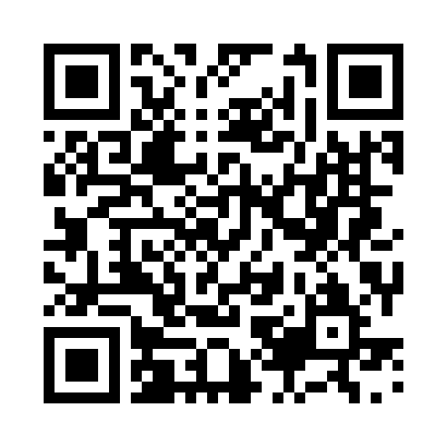

# Consignment Tags: From Item List to Printed Tags



**Get the tool and the latest instructions:**
<https://github.com/scottkuma/consignment-tag-printer>

Scan the QR code with a phone camera to open the repository.

<br clear="all">

This describes how a list of items becomes print-ready price tags using
`consignment_tag_printer.html`.

## Files in this folder

| File | Purpose |
|------|---------|
| `consignment_tag_printer.html` | Self-contained tag generator. Runs locally in the browser; nothing is uploaded. |
| `peddlers_mall_locations.csv` | Source list for the Location dropdown (names are also embedded in the HTML). |
| `CSV Files and Tags/` | Working folder for item-entry CSVs, Consignor Access exports and generated PDFs. |
| `CSV Files and Tags/Archive/` | Dated copies of past exports and tag PDFs. |

## Steps

### 1. Build the item-entry CSV
1. Photograph the handwritten inventory notes (one image per page).
2. Attach the photos and the template CSV file to the chat in Claude or another AI.
3. Use the AI to convert the photos into a combined CSV that follows the
   `Standard_Item_Entry_Template.csv` format
   (output: `Combined_Item_Entry_YYYYMMDD.csv`).

   **Example prompt** (attach the photos and the template CSV to the chat, in Claude or another AI):

   ```text
   I've attached photos of handwritten consignor inventory notes (Item Entry pages),
   plus Standard_Item_Entry_Template.csv.

   Please read every item on every photo and create one combined CSV that follows
   the exact column headers and order of the template.

   Rules:
   - One row per item line. Do not skip, merge or invent items.
   - Keep the item names as written, fixing only obvious spelling slips.
   - Quantity defaults to 1 if none is written.
   - Prices are numbers only (no $ sign), e.g. 12.50.
   - If something is unreadable, still include the row and put "CHECK" in the
     item name so I can find it.

   When done, give me the CSV as a downloadable file named
   Combined_Item_Entry_YYYYMMDD.csv (today's date), then list any rows
   you were unsure about, with the photo and line number.
   ```

   Tip: Some AIs allow you to create a skill that will do this automatically when you upload photos.

4. Skim the CSV and fix any misread names, quantities or prices.

### 2. Import into Consignor Access
1. Log in to Consignor Access (SimpleConsign) and make sure the **Store** at the top right is the correct location (e.g. Lebanon).
2. In the left-hand menu, click **Item Entry**.
3. Click **Import CSV** (next to **+ Add**) and choose `Combined_Item_Entry_YYYYMMDD.csv`.
4. Check that the imported rows appear under **Items To Be Entered** (Name, UPCs, Quantity, Price, Do Not Discount, Category) and fix any problems.
5. Click **Submit** to enter the items.
6. Confirm the items now appear under **Items** with **Status = Active** and have SKUs assigned.

### 3. Export the items list
1. In Consignor Access, export the items list as CSV.
2. Save it in `CSV Files and Tags/` as `Consignor_Access_-_ItemsYYYYMMDD.csv`.
   The tag printer needs these columns: **Item Name, SKU, Quantity, Status, Retail Price**.

### 4. Generate the front tags
1. Open `consignment_tag_printer.html` in a browser.
2. **1. CSV File:** click or drag in the exported items CSV (`Consignor_Access_-_ItemsYYYYMMDD.csv`).
3. **2. Tag Label:**
   - Choose the **Location** from the dropdown (top line of the tag).
   - Enter the **Code** (second line, e.g. `DP006`).
   - Options (defaults in parentheses):
     - Strip trailing "(MERCHANDISE)"-style text from names (on)
     - Only include Status = Active (on)
     - One tag per unit of Quantity (on)
     - Show dashed cut guides (off)
4. Check the preview, then click **Download PDF**
   (saved as `<Location>_tags.pdf`; rename to `<Location>_tags-YYYYMMDD.pdf` if you like).

Location, Code and the Back of Tag settings are remembered in the browser between runs.

### 5. Generate the back-side PDF (optional)
1. In **4. Back of Tag**, set the booth name, font, ink color and optional logo.
2. Leave **Rotate 180°** on if your printer's duplex flips on the long edge.
3. Click **Download Back-Side PDF**. It always has the same page count as the fronts.
   This only needs regenerating if the back design or page count changes.

### 6. Print and cut
- Paper: 8.5" x 11". Tags are 4.15" x 1.05", 2 across x 10 down (20 per page).
- Print at **100% / Actual size** (no "fit to page").
- Print the fronts, flip the stack, then print the backs (or use duplex).
- Cut along the grid and attach the tags.

### 7. Archive
Move the dated item CSV and tag PDF(s) into `CSV Files and Tags/Archive/`.

## Notes
- **Adding or changing locations:** edit the `<select id="locInput">` options in the HTML
  (and update `peddlers_mall_locations.csv` to match).
- **Saved settings** are stored in the browser's localStorage, so they are per browser and
  per file location. A new browser or a moved file starts from the defaults.
- Barcodes are Code128, generated from the SKU column.
